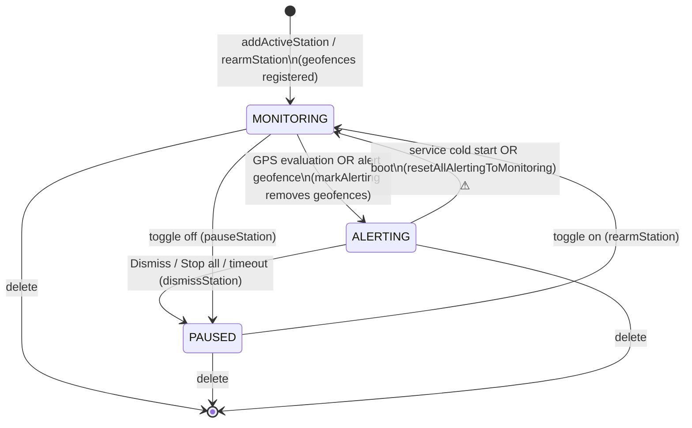

# Alarm engine — trace and edge-case review

**Date:** 2026-10-14 · **Code reviewed:** `main` @ `cf99b02`, every source file, resource and test · **Companion:** [`DESIGN_AND_UX_REVIEW.md`](DESIGN_AND_UX_REVIEW.md)

This is a **static trace**: I followed each user workflow through the code, call by call, looking for ways the
alarm can ring when it should not (**misfire**), fail to ring when it should (**missed alarm**), or end up in a state the
user did not intend (for example **being registered again after the phone is switched off and on**). The station
dataset is out of scope.

Nothing here comes from running the app, except where tagged **[RUN]** (an Android 16 emulator session earlier the same
day). Simulation is deliberately deferred; §9 lists exactly what each later simulation should prove.

| Tag | Meaning |
|---|---|
| **[TRACE]** | Derived by reading the code path step by step. |
| **[RUN]** | Observed on the emulator. |
| **[PLATFORM]** | Depends on documented Android / Play Services behaviour that this repo alone cannot prove — verify before relying on it. |
| **[FIXED]** | Fixed in the commit that adds this file (non-locked files only; each change is listed in §7). |
| **[PATCH]** | Proposed change to a *behaviour-locked* file. **Not applied** — needs your explicit approval (§8). |

---

## 1. How the engine fits together

### 1.1 Where state lives

| State | Lives in | Survives process death | Survives reboot | Note |
|---|---|---|---|---|
| Alarm rows and status `MONITORING / ALERTING / PAUSED` | Room `active_stations` | yes | yes | source of truth |
| `monitoringStations`, `alertingStationIds`, `needsInitialEvaluation`, `waitingForExit` | `LocationService` memory | **no** | **no** | rebuilt from the DB at every service start |
| Hardware geofences (8 ring layers + `alert`) | Google Play Services | yes | **no** | cleared by a reboot and when location services are switched off (`GEOFENCE_NOT_AVAILABLE`) **[PLATFORM]** |
| "Monitoring" / "Station Reached" notifications | system | yes — they outlive the process | no | a stale alert notification can outlive its alarm |
| Sound, duration, volume ramp prefs | DataStore (cached by the service) | yes | yes | |
| Last distance per station | `StationRepository.distancesFlow` | no | no | UI only |

### 1.2 Status machine



The `ALERTING → MONITORING` edge is the one that matters for power cycles (§3, W11).

### 1.3 Three independent ways an alarm starts ringing

| # | Path | Where | Needs | Guards |
|---|---|---|---|---|
| 1 | GPS evaluation | `LocationService.processLocationUpdate` (lines 491–585) | service alive + a fix | `waitingForExit`, `alertingStationIds`, quality gate |
| 2 | Alert geofence | `GeofenceBroadcastReceiver` (115–121) → `markAlertingSync` | GMS geofencing, correct request-ID parse, a real *transition* (the alert layer uses `setInitialTrigger(0)`) | `isArmed` (not PAUSED) only |
| 3 | `ACTION_ALERT_GEOFENCE_TRIGGERED` | `LocationService.onStartCommand` (308–312) | path 2 | duplicate of 2 — harmless (`markAlertingFromMonitoring` is conditional) |

All three converge on a DB write (`status = 'ALERTING'`); `syncWithDatabase` then calls `fireAlert`. No code path
rings an alarm without that DB flip, which is why double-ringing could not be produced by tracing (§4, FP-8).

---

## 2. Findings at a glance

### Missed alarms (the alarm does not ring when it should)
| ID | What | Status |
|---|---|---|
| FN-1 | **Geofence IDs with `_` are mis-parsed → hardware geofences dead for every geocoded/pin alarm** | **[FIXED]** for new alarms (ID sanitising); parser hardening **[PATCH L6]** |
| FN-2 | Boot/restart/app-open **inside** the radius is silently suppressed ("wait for exit") | **design decision** — safe only with a persisted arm-time and trip expiry (§5, §8 "not in the patch set"); the "ambiguous first fix counted as inside" part is **[PATCH L5]** |
| FN-3 | Alarm interrupted mid-ring (kill / power loss) is **dropped** and re-armed as if nothing happened | **[PATCH L3]** (overturns the earlier ghost-alarm decision — your call) |
| FN-4 | Boot crash: first foreground type is `mediaPlayback` → fatal on Android 15+ at every boot with armed (or even only paused) alarms | **[FIXED for paused-only]** · armed case **[PATCH L1]** |
| FN-5 | Android 8.x crash at alarm time (`setPreferredDevice` API 28) | **[PATCH L8]** |
| FN-6 | Edited radius is ignored by the GPS evaluator until the service restarts | **[PATCH L2]** |
| FN-7 | Second alarm inherits the first alarm's countdown and is auto-dismissed early | **[PATCH L4]** |
| FN-8 | Switching Location off/on wipes all geofences; nothing re-registers them | **[PATCH L10]** |
| FN-9 | A queued geofence-cleanup job can delete the geofences of an alarm re-armed in the meantime | **[FIXED]** |
| FN-10 | Rapid toggle off→on: a delayed removal can delete the new geofences | **[FIXED]** |
| FN-11 | FLP stall is masked by the coarse fallback, so the "nuclear reset" never runs | **[PATCH L11]** |
| FN-12 | Unattended alarm auto-stops after 3 min and the station goes PAUSED; hardware keys/Back dismiss it | design decision |
| FN-13 | 4-hour GPS wake-lock cap on overnight trips | **[PATCH L9]** |
| FN-14 | Custom sound from a cloud provider is probed on the main thread → ANR / late alarm | **[PATCH L12]** + Settings change |
| FN-15 | "Armed inside the radius" is silent with no UI explanation (typical for short urban trips at the 5 km default) | design (UX doc) |

### Misfires (the alarm rings when it should not, or too early)
| ID | What | Status |
|---|---|---|
| FP-1 | Accuracy credit: alarm fires up to `accuracy` km early, uncapped | **[PATCH L5]** |
| FP-2 | One outlier fix (network/Wi-Fi/cell "teleport") rings the alarm — no plausibility check, no confirmation | **design** — thresholds must be tuned on recorded trips first; a wrong threshold would reject real fixes, which is worse than the problem (not in the patch set) |
| FP-3 | A stale/late fix (cached `lastLocation` after boot) evaluated after a fresh one | **[PATCH L5]** |
| FP-4 | Alert geofence ENTER is trusted without validation | **design note** — low likelihood (radius ≥ 3 km bounds the error); optional check against `triggeringLocation` |
| FP-5 | **Resurrected alarm:** an alarm that was ringing when the phone died is re-armed and rings again later | **[PATCH L3]** |
| FP-6 | Armed alarms never expire: rings days later, and wakes the foreground service whenever you are within ~R+200 km | design (UX doc) |
| FP-7 | Pin moves to a reverse-geocode centroid kilometres away; a slow reverse-geocode overwrites a newer pin | **[FIXED]** |
| FP-8 | Double ring for one approach | **not reproducible by trace** — see §4 |
| FP-9 | "Test alarm" silences a real ringing alarm after 3 s | **[PATCH L4]** |
| FP-10 | Alert channel has a default sound: "Sound off" still beeps, and the beep stacks on the alarm | **[PATCH L7]** |

### UI-state defects found on the way (all **[FIXED]**)
Same search text typed twice shows nothing · cancelled search flashes "Search unavailable" · stale results reappear
after clearing/selecting · stale distance shown after re-arming · "Alert distance" chip leaks provider IDs (`liq_…`).

---

## 3. Workflow traces

Line numbers refer to files as of `cf99b02`. Functions I changed are cited by name.

### W1 · First launch and permissions
1. `MainActivity.onCreate` → `AppRoot()`. The `ON_RESUME` observer (`AppRoot.kt` ~123–153) launches **one** request for
   `ACCESS_FINE_LOCATION` + `ACCESS_COARSE_LOCATION` (+ `POST_NOTIFICATIONS` on 13+) **before any explanation**.
2. On grant, `showPermissionRationale = true` until background location is granted. That overlay
   (`PermissionRationaleDialog`) covers the whole screen, has one button ("Open Settings") and **no way to decline**.
3. Every later `ON_RESUME` repeats the checks.

Edge cases
- **Denied twice / "Don't ask again":** the launcher is re-fired on every resume and returns instantly with no UI; the app
  shows nothing and offers no Settings link for *foreground* location. Dead end. **[TRACE]**
- **Approximate-only grant (Android 12+):** `hasFineLocation=false` → treated as denied, same dead end. **[TRACE]**
- **Alarm creation with permission denied:** nothing stops it. `addActiveStation` fails with `MissingPermission` and rolls
  back, but `AppRoot` has *already* shown "Alarm set for X" and called `startForegroundService`. With a `location`
  foreground type on Android 14+ that call throws `SecurityException` unless guarded — **this is why patch L1 includes a
  permission check**. **[TRACE]**
- Play requires the disclosure *before* the request, an affirmative choice, and graceful degradation (see the design doc).

### W2 · Create an alarm from the Alarms tab (railway station)
1. Search → `StationData.searchStations` (**[FIXED]** now ranked: New Delhi was previously the 11th match and cut off).
2. Tap → GPS gate (`isGpsEnabled`) → `StationConfigBottomSheet` (defaults: 5 km, all channels on).
3. `onConfirm` (`AppRoot` ~720–787, non-edit branch): `viewModel.addActiveStation(...)`, then immediately
   `startForegroundService(ACTION_START_FOR_ACTIVE_STATIONS)`, then the snackbar "Alarm set", then battery/volume sheets.
4. `StationRepository.addActiveStation` (async): cap check (counts PAUSED rows) → **INSERT … REPLACE** (status
   `MONITORING`) → `GeofenceManager.addGeofencesForStation` (2 GMS calls, 3 attempts at 2 s/4 s) → on failure: delete the
   row, emit an error event.

Edge cases
- **Success message precedes the outcome.** The snackbar and service start do not wait for step 4. On failure the user sees
  "Alarm set" and then, queued behind it, the error — and the card vanishes. **[TRACE]**
- **Insert/service race.** If the service's first Room emission precedes the INSERT it sees no rows and tears itself down
  (`syncWithDatabase` 468–479); the later emission is never seen. Window is milliseconds. **[TRACE]**
- **Re-adding an existing station** REPLACEs the row: status resets to `MONITORING`, `lastTriggeredAt` is wiped, and if it was
  `ALERTING` the service sees the status flip under it. **[TRACE]**
- **Rollback deletes a pre-existing row** if the re-add's geofence registration fails. **[TRACE]**
- **Armed inside the radius** → silent by design (`waitingForExit`), with no explanation and a card showing a full red bar.
  For short urban trips the 5 km default is larger than the trip itself, so the alarm *never* rings. (FN-15) **[TRACE]**

### W3 · Create an alarm from the Map tab (search result or dropped pin)
1. Search results carry provider IDs such as `liq_481312177`; a dropped pin starts as `manual-<ms>` and, when the reverse
   geocode returns, is **replaced by the geocoder's result** (`liq_rev_…`, coordinates too).
2. "Set Alarm" → `Station(id = pin.id, …)` → same path as W2.
3. `GeofenceManager.buildGeofence` names every geofence `geofence_<stationId>_<layer>`; the receiver splits on `_`:

   ```kotlin
   val parts = requestId.split("_", limit = 3)      // GeofenceBroadcastReceiver.kt:92
   val stationId = parts[1]; val layer = parts[2]
   ```
   For `liq_481312177` this yields `stationId="liq"`, `layer="481312177_alert"` → `isArmed("liq")` is false → **every
   hardware geofence event for the alarm is dropped** — the ring wake-ups *and* the alert geofence. **[TRACE]** — unit test
   `StationIdsTest.rawUnderscoreIdBreaksTheReceiversSplit` reproduces the split.
   Impact: for geocoded/pin alarms the service-based GPS path is the **only** mechanism, and §5 shows how weak that is at
   speed. Since the offline list covers India only, this is *every* alarm for users elsewhere. **[FIXED]** (IDs are
   sanitised to `liq-481312177` at the view-model and again at the repository; receiver hardening is **[PATCH L6]**).
4. **Pin placement:** the reverse-geocode result replaced the tapped coordinates unconditionally. Reverse geocoders return the
   *object's* point; for a tap in open country that can be a village centroid kilometres away, silently moving the alarm.
   **[FIXED]** the pin keeps the tapped point unless the geocoder's is within 150 m. **[TRACE]**
5. **Race:** two taps (or a tap then a picked search result) with a slow link: whichever reverse geocode finished *last* won,
   so the pin could jump to the earlier tap. **[FIXED]** (request is tied to the tap that started it).

### W4 · Edit an armed alarm
`updateActiveStationSettings` → DAO UPDATE → remove geofences → add geofences at the new radius (all under the station lock).
The Room emission reaches `syncWithDatabase`, which only handles *new* and *removed* IDs (409–420), so the in-memory
`ActiveStation` keeps the **old** `alertDistanceKm`. Only the radius is stale (sound/vibrate/reminder are re-read from the DB
at alert time, line 427). Consequences: edit 10 → 3 km: GPS fires at 10 km while the geofence is at 3 km (early); edit 3 → 10 km:
GPS waits for 3 km and only the higher-latency geofence covers 10 km. (FN-6) **[TRACE]** — **[PATCH L2]**.
The Edit button is disabled for PAUSED cards (`enabled = isActive`), so the paused-station path I first suspected is not
reachable from the UI.

### W5 · Toggle an alarm off / on
- **Off:** `pauseStation` → DB `PAUSED` → remove geofences (with retries). **On:** `rearmStation` (locked) → `MONITORING` → add
  geofences; on failure revert to `PAUSED`.
- `pause`, `dismiss` and `remove` did not take the per-station lock that arm/re-arm/edit/alert use. A removal that is delayed or
  retried (`removeGeofencesForStation` retries at 0.5/1/2 s) could land *after* a quick re-arm and delete the new geofences,
  leaving a `MONITORING` row with no geofences until the next app open. (FN-10) **[TRACE]** **[FIXED]**.
- After re-arming, the card showed the **previous trip's distance** (`distancesFlow` was never cleaned) instead of "Locating…".
  **[RUN]** observed ("4.0 km" right after re-arm). **[FIXED]**

### W6 · Delete an alarm
`removeActiveStation` → DELETE → remove geofences. If it was ringing, the next Room emission lands in `noLongerAlerting`
(432–443): audio stops, alert notification cancelled. Clean. **[TRACE]**

### W7 · The monitoring loop (service alive, alarm armed)
1. `startLocationUpdates` (912–957): cold start for the first 90 s (5 s, HIGH) then the **distance gearbox**
   (≤5 km 10 s · ≤15 km 30 s · ≤30 km 1 min · ≤60 km 5 min · beyond 10 min; BALANCED priority beyond 100 km). Every request is
   built with `setMaxUpdateDelayMillis(2 × interval)`.
2. Each fix → `processLocationUpdate` → per station: distance, quality gate, `effectiveDistance = distance − accuracy`, initial
   evaluation / wait-for-exit, then `distance ≤ R` → `markAlerting`.
3. Safety nets: coarse `NETWORK_PROVIDER` fallback (cold start; armed after a 3 min stall), `FlpClientGuardian` (nuclear reset),
   30 s watchdog, GPS wake lock.

Edge cases
- **Distance-only gearbox + 2× batching** — a 10-minute sample can be deferred up to 20 minutes. The model (readiness report §5)
  misses at ≥160 km/h when geofences are not available. Combined with FN-1 this was the *only* mechanism for most Map alarms.
- **The coarse fallback masks FLP stalls.** `onCoarseFix` refreshes `lastLocationTimeMs` (LocationService 165–170); the watchdog
  measures stall against that same timestamp (1029–1031), so once coarse is armed the stall is never seen again, the guardian's
  `attemptRecovery()` is never called, and the app stays on 1 km-accuracy network fixes until FLP recovers on its own. (FN-11)
  **[TRACE]**
- **Wake-lock cap:** `acquireGps` takes a 4 h lock and is only re-called when polling restarts. (FN-13) **[TRACE]**
- **Foreground-type switch:** when the last station alerts, `typeChanged` calls `startForeground(MEDIA_PLAYBACK)` from the
  background (858). Whether a service that was *started from boot* may later switch to `mediaPlayback` is **[PLATFORM]** — if it
  may not, this throws inside the sync collector and takes the process down exactly when the alarm should ring.
  L1 wraps it so it can never crash.

### W8 · The alarm rings
`syncWithDatabase` → `fireAlert` (595–729): analytics → alarm wake lock → Crashlytics keys → `playAlarmSound` (probe URI,
two `MediaPlayer`s) → vibrate → timeout job → `showAlert` (full-screen intent + heads-up).

Edge cases
- **App in the foreground:** only a heads-up notification appears; `AlarmActivity` does not launch. **[RUN]**
- **Android 14+ full-screen intent** can be revoked; the app never checks `canUseFullScreenIntent()`. **[PLATFORM]**
- **Second alarm while the first rings:** `startedNewAlarm` is false (697) so no new timeout starts; the first alarm's countdown
  ends **both** and PAUSES the second after whatever ring time it had left (FN-7). `AlarmActivity` ignores `onNewIntent`
  (singleTop), so it can only dismiss the first. **[TRACE]**
- **Hardware keys:** `AlarmActivity.onKeyDown` dismisses on volume up/down/mute, and Back dismisses — an accidental press (pocket,
  Bluetooth buds) ends the alarm **and PAUSES the station**. The on-screen text promises "Press *any* physical button" — only
  those two volume keys work. (FN-12) **[TRACE]**
- **Timeout:** after `alarm_duration` (default 180 s) the service auto-dismisses → `PAUSED`. A sleeper who has not woken gets
  nothing further. (FN-12)
- **Alert wording:** the title says "Station Reached" and the body "You have arrived at your destination", but the alarm fires
  at the *alert radius* (3–20 km away, 2–10 minutes out). The copy is simply wrong for the moment it is shown.
- **Alert channel has a default sound** (`ServiceNotifications.createChannels` never calls `setSound(null)`): "Sound off" still
  beeps, and with Sound on the notification beep layers on top of the alarm. (FP-10) **[TRACE]**
- **Volume side effect:** every ring sets `STREAM_ALARM` to maximum and never restores it, changing the user's *other* alarms.
- **Test alarm** (`handleTestAlarm`): `playAlarmSound` is a no-op while a real alarm rings, but the 3 s timer then calls
  `audio.stopAll()` — silencing the real alarm. **[TRACE]**
- **Custom sound from a cloud provider (e.g. Drive):** `resolveValidatedAlarmUri` and `MediaPlayer.setDataSource` run on the main
  thread inside `fireAlert`. A provider that fetches over the network can block for seconds — contradicting the project's own
  rule 4 (main-thread safety). (FN-14) **[TRACE]**

### W9 · After the ring
Dismiss / timeout / Stop-all → `PAUSED`. The row stays until the user deletes it; there is **no concept of "trip finished"**,
no expiry, no outcome record. To use the same alarm tomorrow the user must toggle it on again. (FP-6, design)

### W10 · App closed, killed, or restarted by the system
- **Swipe from Recents:** `onTaskRemoved` restarts the service if work exists (357–367). Fine on stock Android.
- **OEM "clear all" / force-stop:** Android cancels the app's PendingIntents (geofences) and services; nothing restarts the
  app. Not fixable in code — onboarding must cover it. **[PLATFORM]**
- **System restart of the sticky service (null intent):** `onStartCommand` runs the "all other intents" branch and calls
  `startForeground` again. **[TRACE]**
- **Every service cold start** runs `resetAllAlertingToMonitoring()` (388–399) — see W11.

### W11 · The phone is switched off and on (power-cycle trace)

**What is registered where, and when**

| Trigger | Code | Registers | Side effects |
|---|---|---|---|
| Arm | `addActiveStation` | 9 geofences | — |
| Re-arm | `rearmStation` | 9 geofences | immediate ENTER events for every ring the phone is already inside |
| Edit | `updateActiveStationSettings` | remove, then 9 geofences | same |
| **Boot** | `BootRestoreWorker` | all `MONITORING` rows | same; **also resets `ALERTING → MONITORING` first** |
| **Every process start** | `StationAlarmApplication.onCreate → reconcileOrphans` | all `MONITORING` rows | same; runs concurrently with the boot worker |
| **Every app open** | `MainActivity.onResume → reRegisterAllGeofences` | all `MONITORING` rows | same |

Two things follow from `INITIAL_TRIGGER_ENTER` on the ring layers and `setInitialTrigger(0)` on the alert layer
(`GeofenceManager.kt` 120–129):
1. Re-registering while inside rings fires **one `startForegroundService` per ring** (observed: 8 × `GPS_STARTED` in 1 s
   **[RUN]**), each restarting the location request. Opening the app repeatedly near a station causes this every time.
2. Re-registering **replaces the alert geofence and resets Play Services' inside/outside memory for it**. If the phone is already
   inside the alert radius, no ENTER will ever fire for this approach. That is why the in-service wait-for-exit rule exists —
   and why every restart inside the radius is silent (below).

**Boot sequence** `BOOT_COMPLETED → BootReceiver → BootRestoreWorker.doWork` (33–86):
1. read all rows; if none, finish;
2. every `ALERTING` row → `MONITORING`;
3. re-register geofences for all `MONITORING` rows (retry later if any fails; after 5 attempts post "Restart needed");
4. `startForegroundService(LocationService)` — **this is where the boot crash happens** (FN-4): the service's first
   `startForeground` picks `mediaPlayback` because no station has loaded yet. The worker has already returned success.

**Power-cycle matrix** — what the user gets if the phone is off at each moment and comes back as described

| Moment the phone goes off | DB at next boot | Back on… | Result | Verdict |
|---|---|---|---|---|
| Just after arming, before geofences registered | `MONITORING` | far away | restored by worker / `reconcileOrphans` | ✅ (but see FN-4) |
| En route, far from the station | `MONITORING` | still far | geofences back; GPS polling resumes | ✅ (FN-4 on Android 15+) |
| En route, **inside the radius, alarm not yet rung** (e.g. dies at 6 km, boots at 3 km) | `MONITORING` | inside | first fix inside ⇒ `waitingForExit` ⇒ **silent**. If a stale cached `lastLocation` happens to be *outside*, it consumes the initial evaluation and the alarm rings on the first real fix — **non-deterministic** | ❌ FN-2 |
| En route, phone off **through arrival**, back on beyond the station | `MONITORING` | outside, moving away | **nothing rings, and the alarm stays armed** — it rings the next time you are near this station (days later) | ❌ FP-6 |
| **While ringing** | `ALERTING` → reset to `MONITORING` + geofences re-registered | inside | silent (wait-for-exit) | ❌ FN-3 |
| **While ringing** | same | beyond the station | silent now, **armed again** — rings on the next approach | ❌ FP-5 |
| Just after Dismiss | `PAUSED` | — | nothing to restore (but the worker used to start the service anyway; **[FIXED]**) | ✅ |
| After the 3 min auto-stop | `PAUSED` | — | same | ✅ |
| Before first unlock after reboot | `MONITORING` | — | `BOOT_COMPLETED` is not delivered until the first unlock (the app is not Direct-Boot aware), and geofences were wiped at reboot — **the app does nothing until the user unlocks** **[PLATFORM]** | ⚠️ document |
| Location services off, then on (no reboot) | `MONITORING` | — | geofences wiped (`GEOFENCE_NOT_AVAILABLE`); the receiver logs the error and returns (66–74) **without re-registering**; polling resumes, geofence wake-ups are gone until the next app open | ❌ FN-8 **[PLATFORM]** |

**What I could *not* make misfire:** a second ring for the same approach. Every ring needs the DB flip `MONITORING →
ALERTING`, which is a conditional UPDATE; a late/duplicate geofence event is dropped by `isArmed`; `alertingStationIds` stops
`syncWithDatabase` re-firing; Dismiss writes `PAUSED` before geofences are removed. (FP-8)

### W12 · Environment changes while monitoring
| Change | Handling | Gap |
|---|---|---|
| Location switched off | watchdog (30 s tick) posts "Location is off", forces 10 s polling, recovers on first fix | geofences wiped (FN-8) |
| Location permission revoked | `onLocationResult` stops the service | user not told; with the `location` FGS type a later start throws `SecurityException` (L1 guards) |
| Notifications denied (13+) | FGS still runs | the full-screen alert cannot post → only audio |
| Battery saver / Doze | wake lock + geofences | 4 h cap (FN-13) |
| Do Not Disturb | alert channel `setBypassDnd(true)`; `USAGE_ALARM` audio | vibration uses default attributes; bypass may need Notification-Policy access **[PLATFORM]** |
| Bluetooth connects/drops mid-ring | `AudioDeviceCallback` rebuilds routes | unverified on hardware |
| Incoming call | no special handling | audio-focus result ignored; alarm keeps ringing |
| Airplane mode / no data | GPS + geofences are offline | search/map tiles fail with a typed message ✅ |

### W13 · App update, reinstall, backup restore
- **Update:** the process is killed and the service is not restarted. Whether geofence PendingIntents survive a replace is
  **[PLATFORM]**; there is no `MY_PACKAGE_REPLACED` receiver, so monitoring resumes only at the next ring crossing or app open.
- **Reinstall / new phone:** `allowBackup=true` with the template rules restores `active_stations` as armed alarms with no
  geofences and the wrong environment. Exclude them.

### W14 · Search and map screen state (all **[FIXED]**)
- `distinctUntilChanged()` ran *after* the length filter, so the blank query between two searches never reset it: pick a result
  for "pune", later type "pune" again → no search.
- `CancellationException` (thrown when `mapLatest` replaces a running search) was caught by `catch (e: Exception)`, which set
  "Search unavailable", cleared results and switched the spinner off while the new request was still running.
- Clearing the box or picking a result did not invalidate a search already in flight, so old results reappeared.
- Provider IDs (`liq-…`) were shown to the user as a "station code" chip.

---

## 4. Misfire catalogue

| ID | Trigger | Likelihood | Why the code allows it | Mitigation |
|---|---|---|---|---|
| FP-1 | any fix with poor accuracy | common in tunnels/ghats (cell fixes 1–4 km) | `effectiveDistance = distance − accuracy`; the gate only *raises* accuracy (`max(acc, threshold)`) and beyond 60 km accepts any accuracy; its doc comment says a demoted fix "cannot trigger the alarm" — the opposite is true | cap the credit, e.g. `min(acc, 0.25·R, 1.5 km)`; require confirmation for `acc > 300 m` — **L5** |
| FP-2 | one wrong fix (Wi-Fi/cell database error, moving hotspot, in-train Wi-Fi) | unknown, plausible | `processLocationUpdate` accepts every `Location`; `isMock` is logged but unused; no speed/jump check; no hysteresis | a jump filter (e.g. reject > ~450 km/h from the last accepted fix) plus confirmation by a second fix — **deliberately not in the patch set**: build the replay suite (design doc §6) and tune on real traces first |
| FP-3 | cached `lastLocation` (after boot) arriving after a fresh fix | low | `getLastKnownLocation` (453–461) has no age check; `needsInitialEvaluation` neutralises a stale-inside fix only if it is *first* | ignore fixes older than 2 min and never go back in time (a future-dated fix cannot poison the ordering) — **L5** |
| FP-4 | Play Services reports ENTER from a network-based location | low (radius ≥ 3 km bounds it) | receiver marks `ALERTING` with no check | optional: compare `GeofencingEvent.triggeringLocation` with the station — not in the patch set |
| FP-5 | ring interrupted by kill/power loss | any reboot while ringing | `ALERTING → MONITORING` reset keeps the station armed | resume if recent, else mark consumed — **L3** |
| FP-6 | alarm armed and forgotten / phone off through arrival | common | no `armedAt`, no expiry, no "passed the station" detection | trip lifecycle — design doc |
| FP-7 | pin snapped to a centroid / stale reverse geocode | rural taps, slow links | see W3 | **[FIXED]** |
| FP-8 | double ring | — | — | none found |
| FP-9 | tapping "Test alarm" during a real ring | very low | `stopAll()` after 3 s | **L4** |
| FP-10 | channel default sound | every ring | channel has no `setSound(null)` | new channel id, silent — **L7** |

## 5. Missed-alarm catalogue (extra detail where the table in §2 is not enough)

- **FN-2 vs the stale cache.** Whether an alarm rings after a boot inside the radius depends on what `FusedLocationProviderClient.lastLocation`
  returns, which is not under the app's control (null, hours-old, or yesterday's). An engine whose behaviour depends on a cache
  is hard to trust and impossible to test. Patch L5 removes the dependency on the cache (stale and out-of-order fixes are
  ignored) and stops an *ambiguous* first fix near the boundary from being counted as "inside".
  **What I deliberately did not do:** make "restart / reboot / app-open while inside the radius" ring. I wrote that (apply
  wait-for-exit only to alarms armed in the last two minutes), then removed it after reviewing my own patch: with no
  persisted arm-time and no expiry it creates a *new* misfire — an alarm armed last week and forgotten would ring when you
  reboot at home within the radius. It needs `armedAt` + expiry (a Room v7 migration) and is a product decision (design doc D2/D8).
- **FN-3 and the "ghost alarm" decision.** `resetAllAlertingToMonitoring` was added deliberately (PROJECT_STATE: ghost-alarm
  prevention). The trade-off it makes is: *never re-ring after a restart* at the price of *never resume an interrupted ring*.
  L3 proposes a middle path that needs no schema change: use the already-persisted `lastTriggeredAt` — an `ALERTING` row
  triggered in the last 30 minutes was interrupted and rings again; an older one was consumed and becomes `PAUSED` (never
  silently re-armed).
- **FN-4 root cause and the correct fix.** The first `startForeground` runs before the DB sync (`monitoringStations` is
  empty), so `newIsLocationActive` is false → `mediaPlayback`. Android 15+ forbids that type from `BOOT_COMPLETED`. The
  verified one-line change (prefer `location` on a forced start) fixed the crash on the emulator **only because that emulator
  had location permission granted**. The trace shows it must also (a) check the permission first, because a `location`
  foreground type throws `SecurityException` on Android 14+ without it, (b) not use `location` for the 3 s *Test alarm*,
  and (c) catch platform refusals so a refusal can never kill the process. L1 does all three. **My earlier "verified" patch
  was incomplete; the completed version is the one proposed.**

---

## 6. What I checked and found sound (so you do not re-audit it)

- Status transitions are conditional/idempotent; no path produces a double ring (§1.3, FP-8).
- `isArmed` correctly drops late geofence events after dismissal.
- Per-station mutex around arm/re-arm/edit/alert (now also pause/dismiss/remove): no nested acquisition of the same mutex
  anywhere, so no deadlock was introduced.
- `BootReceiver` de-duplicates via unique work (`KEEP`); `reconcileOrphans` and the boot worker both registering is idempotent
  (same request IDs replace).
- The rollback in `addActiveStation` and `rearmStation` keeps the UI honest about registration failures.
- Geofence count: 9 per station × 10-station cap = 90 ≤ the 100 per-app limit.
- `LogEntry.toCsvLine` escapes commas/quotes/newlines correctly.
- R8: Room, Retrofit models and WorkManager workers survive minification ([RUN] the boot worker ran in the release build) — apart from the Gson `TypeToken` rule, now added.

---

## 7. Changes made in this commit (non-locked files, each verified)

| Change | Bug | Verification |
|---|---|---|
| `proguard-rules.pro`: keep Gson `TypeToken` | release build could not load the station list | **[RUN]** reproduced on a minified build, then fixed on the same build |
| `AndroidManifest.xml`: strip `AD_ID` / `ADSERVICES_*` | manifest contradicted "no advertising ID" | `aapt2 dump badging` showed the three permissions before; **on the final minified APK they are absent** (two inert Privacy-Sandbox config entries from Firebase remain — they are not permissions) |
| `util/StationIds.kt` + `MapSearchViewModel` + `StationRepository.addActiveStation` + `StationDisplay` | FN-1: `_` in geofence IDs | **[TRACE]** + unit tests `StationIdsTest` (incl. the split reproduction) |
| `MapSearchViewModel`: search pipeline, cancellation, stale results, tap race, pin snap (`util/GeoMath.kt`) | W3, W14 | **[TRACE]** + `GeoMathTest`; compiled |
| `data/StationIndex.kt` + `StationData.searchStations` | search ranking | ported to Python and run against the real list: "delhi" → New Delhi rank 2 (was 11, cut off); exact codes always first; exact-code regression sample passes; `StationIndexTest` |
| `OsmMapView`: `CopyrightOverlay` | missing OSM attribution | compiled; class present in the minified APK; **simulate later**: visible, not hidden by the bottom bar |
| `BootRestoreWorker`, `MainActivity.onResume`: only act when something is armed | needless service start / notification flash / boot crash for paused-only users | **[TRACE]** |
| `GeofenceCleanupWorker`: skip when the station is armed | FN-9 | **[TRACE]** (job queued with backoff from 30 s up to hours; the check reads the live status) |
| `StationRepository`: lock pause/dismiss/remove; clear stale distance; atomic distance update | FN-10, stale card | **[TRACE]** (no nested mutex acquisition) |

Unit tests added: `StationIdsTest` (7), `GeoMathTest` (6), `StationIndexTest` (8).

---

## 8. Proposed changes to behaviour-locked files — **not applied, need your approval**

CLAUDE.md freezes `LocationService`, `AlarmAudioController`, `ServiceWakeLocks`, `ServiceNotifications`, `GeofenceManager`
and `GeofenceBroadcastReceiver` against behavioural change without explicit approval, so none of this is in the repository's
code. It is one reviewable patch: [`docs/proposed-patches/locked-file-fixes.patch`](proposed-patches/locked-file-fixes.patch)
(931 lines; 6 production files, 4 new small helper classes, 4 new test files).

**What I did to verify it (and what I did not):** it applies to this repo (`git apply --check`), compiles, and **88 / 88 unit
tests pass** — including 28 new ones for the decision rules, which I extracted into plain classes (`AlarmMath`, `FixFreshness`,
`AlarmRecovery`, `GeofenceIds`) so they can be tested without the Android runtime. A first version of my own patch failed a test
(my test's timestamps were wrong) and my self-review of the diff changed it in four places (listed under L3, L4, L5 and L12).
It has **not been simulated** — §9 lists what each run must prove. To apply: `git apply docs/proposed-patches/locked-file-fixes.patch`,
or tell me which items you approve and I will rebuild the subset.

| ID | Where | Change | Fixes | Traced against | What could go wrong | My call |
|---|---|---|---|---|---|---|
| **L1** | `LocationService` | A forced start asks for `LOCATION` (not for the 3 s *Test alarm*); checks the location permission first; `startForeground` is wrapped — a refused type falls back to the other, and if neither is accepted the service stops cleanly; a refused later switch is not retried every update | FN-4 (boot crash), `SecurityException` when permission is missing, a refused `mediaPlayback` switch crashing at alarm time | cold start, boot, geofence start, UI start, test alarm, alert-only switch, permission missing, [RUN] the original crash | with permission missing the service now runs as `mediaPlayback` without tracking (silent) — a "tracking is off" notice belongs to the health feature | **recommend** |
| **L2** | `LocationService` | existing in-memory stations are refreshed from every DB emission (live distance kept) | FN-6 (edited radius ignored) | W4 | none found — copy with the same distance | **recommend** |
| **L3** | `LocationService`, `StationRepository`, `BootRestoreWorker`, `util/AlarmRecovery` | rows still `ALERTING` at service start / boot: rang ≤ 30 min ago → stay `ALERTING` and ring again; older → `PAUSED` (never silently re-armed) | FN-3, FP-5 | W11 matrix; 5 tests on the rule | **overturns your earlier "ghost alarm prevention" decision** (it chose *never re-ring after a restart*). Risk: if the alarm path itself crashes, the service retries ringing for up to 30 minutes (bounded; L1/L8 remove the known crashes). *Self-review change:* I had also made "restart inside the radius" ring — removed, see below | **your decision** |
| **L4** | `LocationService` | the countdown restarts for every alert that rings/vibrates (a silent alert does not extend another's ring); *Test alarm* is skipped while a real alarm is active | FN-7, FP-9 | W8 | a second alarm extends the first one's ring | **recommend** |
| **L5** | `LocationService`, `service/gps/AlarmMath`, `FixFreshness` | (a) fixes older than 2 min or older than the newest seen are ignored (a future-dated stamp cannot poison the ordering); (b) the accuracy credit is capped at `min(accuracy, R/4, 1.5 km)`; (c) only a *surely inside* fix silences an alarm armed inside | FP-1, FP-3, the "ambiguous first fix counted as inside" part of FN-2 | numeric cases in `AlarmMathTest`; 18 tests | (b)/(c) move the ring point for **poor** fixes (never for good GPS); an ambiguous first fix near the boundary can now ring at arming. *Self-review change:* added the future-timestamp clamp after finding it could blind the alarm | **recommend**; simulate S10/S11 |
| **L6** | `GeofenceBroadcastReceiver`, `receiver/GeofenceIds` | request IDs are parsed from the end; unknown layers are rejected | hardens B9 (also covers alarms created before ID sanitising) | 5 tests incl. `liq_…` IDs | none | **recommend** |
| **L7** | `ServiceNotifications` | new silent alert channel `alarm_channel_v2`; old one deleted | FP-10 ("Sound off" beeps; double beep) | — | previously customised channel settings are reset | **recommend** |
| **L8** | `AlarmAudioController` | API-28 guard for device routing (one default route below it); `setStreamVolume` guarded | FN-5 (Android 8 crash), `SecurityException` under DND | lint `NewApi` | on API 26/27 the dual speaker+headphone routing is not available | **recommend** |
| **L9** | `LocationService` | GPS wake lock is topped up on each watchdog tick | FN-13 (4 h cap) | `acquireGps()` is a no-op while held | slightly longer CPU wake time on overnight trips | **recommend** |
| **L10** | `LocationService` | when location services come back on, geofences are re-registered | FN-8 | W12 | each re-registration fires the ring-layer events once if inside rings; relies on the [PLATFORM] behaviour (S9) | **recommend** |
| **L11** | `LocationService` | an FLP stall is detected even while the coarse fallback keeps delivering | FN-11 | W7 | one extra one-shot GPS request per 30 s while stalled | **recommend** |
| **L12** | `LocationService` | the custom-sound probe runs on IO with a 2 s timeout, falling back to the default sound | FN-14 (partly) | W8 | a slow provider now means the default sound instead of a stalled app | **recommend** |

### Not in the patch set (and why)

| Item | Why it is not here |
|---|---|
| **"Restart / reboot inside the radius should ring"** (FN-2) | I wrote it, then removed it: with no persisted arm-time and no expiry it creates a new misfire — a forgotten alarm rings when you reboot at home near that station. Needs `armedAt` + expiry (Room v7) and a product decision (design doc D2/D8). |
| **Fix plausibility / jump filter** (FP-2) | The threshold must be tuned on recorded trips. A threshold that is too tight rejects *real* fixes — a worse failure than the one it prevents. Build the replay suite first (design doc §6). |
| **Trip expiry, outcomes, repeat** (FP-6) | Needs the same Room v7 columns. |
| **Hardware keys silence-only** (FN-12) | Needs a new service action and your decision (D4). |
| **Alert geofence vs `triggeringLocation`** (FP-4) | Low likelihood given the ≥ 3 km radius. |
| `AlarmActivity.onNewIntent` / multi-alarm screen, success-before-outcome snackbar, copying the chosen sound into app storage, `GEOFENCE_NOT_AVAILABLE` handling in the receiver | UI/product work, better done together with the health feature. |

---

## 9. What to simulate later (and what each run must prove)

| # | Simulation | Must show |
|---|---|---|
| S1 | Boot with an armed alarm on Android 15/16, location granted | no crash; foreground `location` type; geofences re-registered (before/after L1) |
| S2 | Boot with only a paused alarm | no service start (this commit) |
| S3 | Boot with location permission revoked | no crash; sensible state (L1 permission check) |
| S4 | Map alarm for a geocoded place: cross the ring and alert radius | `GEOFENCE_TRIGGERED` appears for `liq-…` ids (this commit); before: never |
| S5 | Arm inside the radius, then restart the app | still waits (unchanged — restart-inside is a design decision, not in the patch set) |
| S6 | Kill the app process during a ring; also power-cycle during a ring | ring resumes within the 30 min window; older rows go to `PAUSED`, never back to `MONITORING` (L3) |
| S7 | Edit radius 10 → 3 km while at 8 km | GPS path uses 3 km (L2) |
| S8 | Two alarms 1 min apart, first unattended | second gets its own full duration (L4) |
| S9 | Location off then on | geofences re-registered (L10) |
| S10 | Inject a one-off far-away fix inside the radius | alarm does **not** ring until a second consistent fix (L5) |
| S11 | Inject a 10-minute-old `lastLocation` after boot | ignored (L5) |
| S12 | Dismiss while Play Services is unreachable, then re-arm, wait for the cleanup job | live geofences survive (this commit) |
| S13 | Map tab: tap A, tap B quickly on a throttled link; pick a search result while a reverse geocode is running | pin never reverts (this commit) |
| S14 | Tap far from any address; tap on a station building | far tap keeps the tapped point; building snaps (this commit) |

---

## Appendix A · File-by-file review

| File | Verdict / notable points |
|---|---|
| `StationAlarmApplication` | init order fine; **main-thread IO** at start: `Logger`/`GpsLogger` MediaStore insert+open, DataStore `runBlocking` (a geofence cold start pays for all of it) |
| `MainActivity` | each resume re-registers + restarts the service (churn); `requestFreshLocation()` discards its result; no `launchMode` (notification taps stack instances) |
| `ui/AppRoot` | W1 dead ends; success snackbar before outcome; hard-coded white dialogs in dark mode |
| `ui/screens/HomeScreen` | fine; search on the main thread (cheap now); "Notify" badge reflects a flag the engine ignores |
| `ui/screens/MapSearchScreen`, `OsmMapView` | attribution added; re-zooms on every slider tick |
| `ui/screens/StationConfigBottomSheet` | "Notify" chip is a no-op; radius 3–20 km only; no "already inside" warning; "Ring when within" vs map "Perimeter" wording |
| `ui/screens/SettingsScreen` | language section to be removed (English-only); "Debug Logs" visible in release |
| `ui/screens/AboutScreen` | privacy link points at a host that does not resolve; placeholder icon |
| `ui/screens/AlarmActivity` | no `onNewIntent`; volume/Back dismiss; copy "any physical button" is inaccurate |
| `ui/screens/BatteryOptimizationSheet`, `ui/theme/*` | fine |
| `ui/viewmodel/MapSearchViewModel` | 4 defects fixed (W3, W14) |
| `ui/viewmodel/StationViewModel` | fire-and-forget calls — cannot report registration outcome |
| `data/ActiveStation` | rings R+5/30/40/60/100/150/200 + alert; `var currentDistanceKm` mutated across threads (the earlier hash-drift bug's cousin) — keep it out of data-class identity |
| `data/db/*` | schema v6, migrations 2→6 present, schemas 3–6 committed; no migration tests |
| `data/StationData`, `data/StationIndex` | search ranked; JSON loaded async (search returns nothing for the first ~0.5 s) |
| `data/UserPreferences` | fine; locale keys go with the English-only cleanup |
| `geofence/GeofenceManager` **(locked)** | request-ID format is the root of FN-1; `GEOFENCE_NOT_AVAILABLE` not handled anywhere |
| `geofence/GeofenceCleanupWorker` | FN-9 fixed |
| `receiver/GeofenceBroadcastReceiver` **(locked)** | parse bug; alert trusted blindly; one service start per ring; error path never re-registers |
| `receiver/BootReceiver`, `BootRestoreWorker`, `NotificationRestoreReceiver` | gating fixed; boot worker reports success even when the service it started crashes; ALERTING reset (W11) |
| `repository/StationRepository` | locks/distance fixed; `addActiveStation` is fire-and-forget; cap counts PAUSED rows |
| `service/LocationService` **(locked)** | L1–L5, L9, L10, L11 |
| `service/AlarmAudioController` **(locked)** | API 28 call, unguarded `setStreamVolume`, volume never restored, vibration without alarm attributes |
| `service/ServiceNotifications` **(locked)** | default channel sound; placeholder small icons |
| `service/ServiceWakeLocks` **(locked)** | 4 h GPS cap; 10 min alarm cap < 15 min max duration |
| `service/gps/*` | `FixQualityGate` credit/doc mismatch; guardian logic sound but masked (FN-11); coarse accuracy floored at 1 km ✅ |
| `network/*` | contract clean; Remote-Config URL is a trust point |
| `util/Logger`, `GpsLogger`, `LogEntry` | public Downloads, per-start files, no rotation, main-thread init |
| `util/Analytics`, `AppRemoteConfig` | safe; no consent flow for EEA users |
| `util/BatteryOptimizationHelper`, `DistanceUnit`, new `StationIds`, `GeoMath` | fine |
| resources / manifest | AD_ID stripped; `allowBackup` rules empty; copy issues listed in the design doc |

## Appendix B · Assumptions to verify on a device ([PLATFORM])
1. Geofences are removed by a reboot and by location-services-off (`GEOFENCE_NOT_AVAILABLE`); they survive an app update.
2. A service that started from `BOOT_COMPLETED` may not later switch to `mediaPlayback`.
3. `setBypassDnd(true)` is honoured without Notification-Policy access.
4. Vibration without `USAGE_ALARM` attributes is not suppressed under DND or for background apps.
5. A sticky-restarted service may call `startForeground` from the background.
