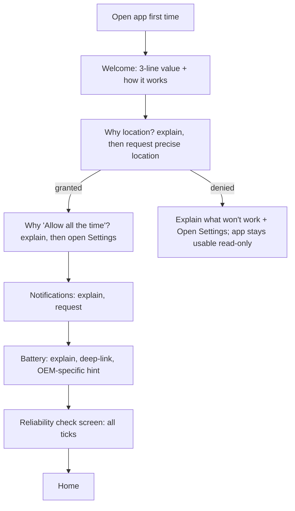
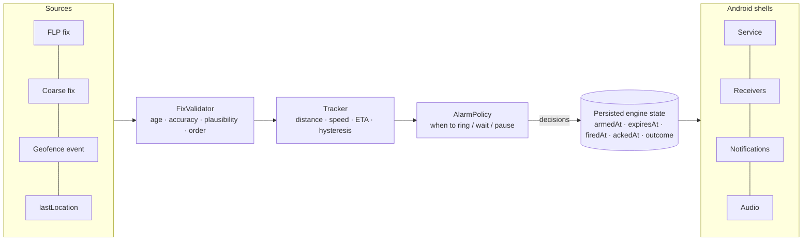

# Design and UX review — what StationAlarm should be

**Date:** 2026-10-14 · **Companion:** [`ALARM_ENGINE_TRACE.md`](ALARM_ENGINE_TRACE.md) (the code-level findings this builds on)
**Scope:** English only; India-first, global-capable. Ideas are ordered by impact; nothing here has been built.

---

## 1. What the app already does well — keep it

- **Two independent detection paths** (foreground GPS tracking + hardware geofences) and a watchdog that heals instead of nagging.
- **Honest failure handling** in places: audio falls back from custom → default → vibration + a notice; boot restore escalates to a user
  notification; geofence registration failures roll the alarm back instead of leaving a ghost.
- **Wake-up-friendly sound**: escalating volume, dual routing to speaker and headphones, a *Test alarm* button.
- **Operational control**: Remote-Config kill switches and a version floor; structured logs with GPS telemetry.
- **A calm, consistent visual language** (glass cards, semantic colours, M3 tokens).

The weaknesses are not in the engineering ambition — they are in *what the app promises versus what it can prove*, and in a
few product defaults that work against the person this app is for: someone asleep on a train.

---

## 2. Principles to decide against

1. **Be honest about state.** The user should always be able to see whether the alarm *can* ring right now, and why not.
2. **Fail loud.** A condition that makes the alarm unreliable (permission, battery, Location off, service dead) must produce a
   visible warning — never a silent no-op.
3. **One acknowledged ring per trip.** Ring until acknowledged; never ring again after acknowledgement; never lose an unacknowledged ring.
4. **Time beats distance.** People need *minutes* of warning; kilometres mean different things at 40 and 160 km/h.
5. **Easy to arm, hard to dismiss by accident.** One tap to arm; a deliberate gesture to dismiss.
6. **Never surprise.** No alarm days later, no foreground service waking the phone when you are merely nearby.
7. **A testable core.** Alarm decisions are pure functions of (fix, config, state, clock) so they can be replayed from recorded trips.

---

## 3. Decisions that need your call

| # | Decision | Today | Options | Recommendation |
|---|---|---|---|---|
| D1 | **How "when" is expressed** | km slider 3–20, default 5 | A) keep km · B) **minutes before arrival** (derived from speed) with a km floor · C) both | **B**, presets 10 / 20 / 30 min (default 20) with a 3 km backstop. At 130 km/h, 5 km is 2.3 min; a sleeper needs 15–30. |
| D2 | **Trip lifecycle** | armed until the user turns it off; no expiry | A) as today · B) auto-expire (6/12/24/48 h) · C) B + "you passed it" detection + outcomes | **C**, default 24 h. Fixes FP-6 (rings days later, wakes the service whenever you are within ~R+200 km). |
| D3 | **What a ring does** | rings 3 min then PAUSES | A) as today · B) ring until acknowledged · C) 10 min max, re-ring every 2 min, snooze | **C**. Never silently give up on a sleeper. |
| D4 | **Hardware keys / Back** | dismiss + PAUSE | A) as today · B) silence sound only, dismiss needs on-screen gesture | **B**. Accidental dismissal is the costliest failure. |
| D5 | **An early/false ring that is dismissed** | alarm is dead (PAUSED) | A) as today · B) if still > 2×R away after dismissal, keep it armed and say so | **B**. Turns a false positive from "missed stop" into "one annoying ring". |
| D6 | **Arming while already inside the radius** | silent forever (`waitingForExit`) | A) as today · B) warn + auto-pick a smaller radius · C) ring on arrival at a derived distance | **B/C**: show "You're 2.4 km away — already inside 5 km. I'll ring within 1 km instead." |
| D7 | **Location permission** | forced "Allow all the time"; blocking overlay | A) as today · B) staged explanation, with a limited "while using" mode | **A with a better flow**: explain first, then request; offer limited mode only if you accept weaker reliability after reboot/kill. |
| D8 | **Phone restarts mid-trip** | restore geofences; suppress if inside; drop interrupted ring | A) as today · B) resume ring if recent, ring if inside, "passed it" notice if beyond | **B** (patch L3 + trip lifecycle). |
| D9 | **Launch geography** | global | A) global · B) India first | **B**: the offline list is India-only, the Worker/LocationIQ quota is small, GDPR consent is not implemented, OSM tiles are not production-grade. |
| D10 | **On-device diagnostics** | precise GPS traces in public Downloads, always on | A) as today · B) debug-only · C) opt-in, private, capped | **C**. Keep the telemetry — it is how you will tune D1/D5 — but not in public storage. |

---

## 4. UX proposals by screen

### 4.1 First run and permissions
**Problem:** the system dialogs appear before any explanation; denial is a dead end; one blocking overlay.
**Flow:**


Rules: never show a system dialog the user has not been prepared for; a denial must lead to an explanation with a Settings
link, not silence; approximate-only location gets its own message ("Precise location is needed — alarms can be several km off otherwise").

### 4.2 Alarms tab (home)
- **Health header** above the list — the single most valuable addition:
  `✔ Tracking · GPS locked · Next: Pune Jn 48 km (~36 min)` or a red banner `Your alarm may not ring — Location is set to "While using the app" [Fix]`.
- **Cards** show ETA as well as distance, the lead time ("rings ~20 min before"), and a one-line status:
  *Watching · Rings at 05:12 (est.)* / *Waiting — you're inside the radius* / *Ringing* / *Rang 05:12, 4.9 km before* / *Missed — you passed it*.
- **Outcome history** (last 3 per alarm) — builds trust and gives you field data.
- Remove the **Notify** badge/chip (the engine ignores it) or make it mean "show on lock screen".
- Empty state: add a one-tap example ("Try it: set an alarm for the next stop").

### 4.2.1 Create / edit sheet (proposed)

```
┌─────────────────────────────────────┐
│ Pune Jn                         PUNE │
│ You're 142 km away                    │  ← from last known location
├─────────────────────────────────────┤
│ Wake me                               │
│ ( 10 min ) [ 20 min ] ( 30 min ) ( km )│
│ ≈ 27 km at train speed. Backup: also   │
│ rings within 3 km.                     │
├─────────────────────────────────────┤
│ Alert with   [🔊 Sound] [📳 Vibrate]    │
│ Note ______________________________   │
│ Repeat  Never ▾   (Mon–Fri / Every day)│
├─────────────────────────────────────┤
│            [   Set alarm   ]          │
│              Test sound               │
└─────────────────────────────────────┘
```
Inside-radius variant: *"You're already within 5 km. I'll ring when you're within 1.0 km."* with the number adjustable.
Remember the last settings as the next default. Use the same words on both tabs ("Wake me within", not "Perimeter" vs "Ring when within").

### 4.3 Map tab
- Show the user's position and accuracy; show the alert circle *and* its time equivalent.
- After a tap, label the pin as *"your point"* and show the address as a hint; never move the pin silently (done in this commit).
- Recents and favourites for places (Home, Work, Parents' station).
- Keep the OSM attribution visible (added) and consider a production tile source before growth.

### 4.4 The alarm screen (what the user sees at 4 a.m.)

```
              Approaching
               PUNE JN
         about 4.2 km · ~3 min
     "Get the blue bag from the rack"     ← the note
 ┌─────────────────────────────────────┐
 │   ▶▶▶  slide to dismiss  ▶▶▶       │
 └─────────────────────────────────────┘
              Snooze 2 min
     Volume buttons silence the sound
```
- Ring until acknowledged (D3); volume keys **silence**, they don't dismiss (D4); dismiss needs a slide/hold.
- Show *Approaching* — not *Arrived*: the alarm fires kilometres before the station.
- Handle several alarms on one screen (a stack, "2 stations reached").
- After dismissal, a 10-minute notice action **Re-arm** (D5).
- High contrast, large type, TalkBack-friendly dismiss.

### 4.5 Notifications

| Where | Today | Proposed |
|---|---|---|
| Persistent | "Nearest station: PUNE JN — 3.2 km" | "Pune Jn · 48 km · ~36 min" + **Pause** and **Stop all** |
| Alert title | "Station Reached: PUNE JN" | "Approaching PUNE JN — about 4 km" |
| Alert body | "You have arrived at your destination." | "Get ready — about 3 minutes to go." |
| Health | (none) | high-priority "Your alarm may not ring: <reason> — tap to fix" |
| After restart | "Restart needed" (only after 5 failed retries) | "Your alarm for X was restored" (silent) or "You may have passed X" |
| Icons | system `ic_dialog_info` (renders as a robot) | a monochrome app glyph |

The alert channel should be **silent** (the app plays its own sound) so "Sound off" really is off and nothing doubles up (FP-10).

### 4.6 Settings
Group as *Alarm* (sound, test, volume ramp, duration, snooze) · *Reliability* (the checklist below) · *Appearance* (theme, units) ·
*About*. Remove **Language** (English-only) and **Debug Logs** from release; if you keep diagnostics, make them an explicit opt-in
("Help improve reliability — save anonymous trip diagnostics on this phone").

### 4.7 Copy fixes (all in `strings.xml`)

| Key | Today | Proposed |
|---|---|---|
| `alarm_screen_wake_up` / `alarm_screen_arrived_at` | "Wake Up!" / "Arrived at" | "Approaching" / "PUNE JN" |
| `alarm_screen_press_button_hint` | "Press any physical button to dismiss" (only two volume keys work) | "Volume buttons silence the alarm" |
| `notif_alert_title_format`, `notif_alert_body_default` | "Station Reached…", "You have arrived…" | see §4.5 |
| `map_perimeter` vs `alarm_config_ring_when_within` | two terms for one idea | "Wake me within" everywhere |
| `settings_battery_exempt_yes` | "Unrestricted — alarms will fire reliably" (a promise) | "Unrestricted — best chance of a reliable alarm" |
| `notif_monitoring_count_format`, `notif_alarm_ringing_count_format` | "%d station(s)…" | plurals ("Watching 2 alarms") |
| `home_hint_type_more` | "Type at least 2 characters" (map needs 3) | align both to 2 |
| `gps_disabled_title/body` | "GPS Disabled" | "Location is off — alarms can't work" |
| `home_remove_body_format` | "This will stop monitoring %s." | "Delete the alarm for %s?" |
| `settings_language_*` (24 keys) | — | delete with the English-only cleanup |

---

## 5. Reliability UX — an "Alarm health" checklist

One screen (and the header on Home) that evaluates what actually decides whether an alarm rings.

| Check | How to detect | If failing |
|---|---|---|
| Location "Allow all the time" | `ACCESS_BACKGROUND_LOCATION` | explain → Settings |
| Precise (not approximate) | `ACCESS_FINE_LOCATION` | explain → Settings |
| Location services on | `LocationManager.isLocationEnabled` | location settings dialog |
| Google Location Accuracy on | geofence registration status `1000` | explain → resolution dialog (**not** a raw "1000:") |
| Notifications allowed + Alerts channel not blocked | `areNotificationsEnabled`, channel importance | → channel settings |
| Full-screen alerts allowed (Android 14+) | `canUseFullScreenIntent()` | → `ACTION_MANAGE_APP_USE_FULL_SCREEN_INTENT` |
| Battery "Unrestricted" | `isIgnoringBatteryOptimizations` | existing sheet; add OEM hints (Xiaomi/Oppo/Vivo/Realme/Samsung autostart) |
| Alarm volume ≥ 50 % | `STREAM_ALARM` | existing dialog |
| Do Not Disturb lets alarms through | policy access / current filter | optional |
| Tracking alive | service running + last fix < 2 min | "Restart tracking" |
| Phone restarted since arming | boot count / `BootRestoreWorker` result | "Unlock once so StationAlarm can restore your alarm" |
| Last test alarm | stored timestamp | "Test now" |

A **heartbeat** (WorkManager periodic, ~15 min, only while something is armed) re-registers geofences, restarts the service if it
is dead, and posts the health notification if it cannot. That one job covers OEM kills, Location off/on, app updates and
the post-reboot gap.

---

## 6. Architecture — what it should be

The service today owns detection, state, audio, notifications and lifecycle, and its decisions depend on hidden state
(`waitingForExit`, caches, a stale `lastLocation`). Target shape:



- **Pure Kotlin core** (no Android types): `FixValidator`, `Tracker`, `Gearbox` (interval from **ETA**, not distance), `AlarmPolicy`.
  Inputs are values plus a clock; outputs are decisions. Fully unit-testable.
- **Replay tests from real data.** `GpsLogger` already records `timestamp, lat, lon, accuracy, speed, interval…`. Feed recorded trips (and
  synthetic ones: tunnels, teleports, stops, reboots) through the core in CI — the simulation in the readiness report becomes a regression suite.
- **Persisted trip state** (Room v7 migration): `armedAt`, `expiresAt`, `firedAt`, `ackedAt`, `outcome`. This replaces the in-memory guesses
  (`needsInitialEvaluation`, `waitingForExit`, "was this ALERTING row stale?") with facts, and enables D2, D5, D6 and D8.
- **Three layers of defence**: GPS tracker (primary) → hardware geofences (wake + backup) → **dead-reckoned backup alarm** via
  `AlarmManager.setAlarmClock` (no exact-alarm permission needed) scheduled from ETA, cancelled when the service confirms; rings
  as "estimated" only if tracking has gone silent.
- **Migration path (strangler, one PR each, each with tests):** extract `Gearbox` → `FixValidator` → `AlarmPolicy` → persisted trip
  state → heartbeat worker. The locked service becomes a thin adapter; behaviour changes happen in the tested core.
- **Smaller hygiene items:** one function to build geofence parameters (the 8-radius argument list is repeated five times in the
  repository); keep `currentDistanceKm` out of the `ActiveStation` data class; make `addActiveStation` return a result so the UI can wait for it.

---

## 7. Roadmap

| When | Item | Impact | Effort |
|---|---|---|---|
| **Before launch** | Fix crash/ID/R8 items (done / patch set) · privacy policy live and accurate · real icon · health header + onboarding explanation · copy fixes · silent alert channel · hardware keys silence only | very high | S–M |
| **Before launch** | D5 auto-keep-armed after an early dismissal · "already inside" warning (D6) · ring-until-acknowledged + snooze (D3) | high | M |
| **First update** | Minutes-based lead (D1) · trip expiry + outcomes (D2) · Room v7 trip state · heartbeat worker | very high | M–L |
| **First update** | Reliability checklist screen · OEM-specific guidance · opt-in diagnostics (D10) | high | M |
| **Later** | Pure-core extraction + replay suite · dead-reckoned backup alarm · commuter repeat/widgets/quick tile · production tile source · Play-Integrity-protected Worker | high | L |

## 8. How to know it works — measures

Local-first, privacy-preserving, aggregated:
- **Lead time at ring** (minutes before arrival) — target ≥ 10 at median.
- **False-ring rate** — dismissed within 10 s while distance > 2×R.
- **Missed-alarm proxy** — an armed station passed (distance rose after being within R+X) with no ring.
- **Health-check failures by cause**, by manufacturer and Android version.
- **Time-to-dismiss** and **auto-stop rate** (rings nobody acknowledged).
- **Restore success after reboot** and **time-to-first-fix after boot**.

## 9. Accessibility and polish

TalkBack labels on every icon-only control and a non-gesture alternative to slide-to-dismiss · touch targets ≥ 48 dp
(the card action buttons are 40 dp) · dark-mode dialogs use theme colours (three dialogs are hard-coded white/black) · respect font
scale on the alarm screen · landscape/tablet layouts · `launchMode=singleTop` for `MainActivity` so a notification tap does not stack instances.
